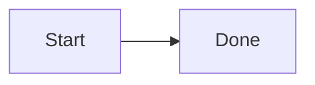

# DevHub · FE Panel

An internal web panel for a small frontend team: a per-user **Dashboard**, a simple notes-style **Backlog**
(manual entry and AI prompt-based entry), **Projects**, a curated **Learning** section and per-project
**Docs** (Markdown, charts, wireframe images, Mermaid diagrams).

One **Admin** creates, edits and deletes everything. Everyone else is a **Viewer**: read-only, except that
**any signed-in user can change a backlog item's status**.

Sign-in is **email + password, then a 6-digit code from an authenticator app** (TOTP: Google Authenticator,
Microsoft Authenticator, Authy, 1Password…). There is no self sign-up: the admin adds people with a name,
email and temporary password. On first sign-in each person scans a QR code to set up the authenticator app
and then chooses their own password.

> Built to the MVP in *Frontend Developer Panel: Requirements v1.2* and the *UI Design Brief v1.0*.
> All names, emails and passwords in the seed data are fake development values.

## Folder structure

```
devhub/
├── docker-compose.yml        # Postgres (local dev)
├── backend/                  # API service: Express 5 + TypeScript + Prisma
│   ├── prisma/               # schema.prisma, migrations/, seed.ts (fake example data)
│   ├── src/
│   │   ├── index.ts          # server entry (listen on PORT)
│   │   ├── app.ts            # Express app, routers, viewer guard, Origin check, error handler
│   │   ├── auth/             # sign-in routes (password, TOTP, password change), DB sessions, middleware
│   │   ├── routes/           # me, users, dashboard, backlog, ai, projects, learning, docs, uploads
│   │   └── lib/              # zod schemas, argon2 passwords, TOTP + QR, AES-GCM secret encryption,
│   │                         # rate limiter, activity log, LLM client, draft parser, storage
│   └── tests/                # permissions, password + TOTP (unit + DB flow), AI draft parser (vitest)
└── frontend/                 # Next.js 16 (App Router) + TypeScript + Tailwind CSS 4
    ├── app/                  # /login (password, QR setup, code, new password) and the signed-in app
    ├── components/           # UI kit, backlog list + form, AI prompt + draft preview, Markdown/Mermaid/Chart, doc editor
    └── lib/                  # API client, types, formatting
```

The two apps are independent (separate `package.json`, lockfile and env file). The browser only talks to the
frontend; Next.js proxies every `/api/*` request (including sign-in at `/api/auth/*`) to the backend, so the
httpOnly session cookie is first-party locally and on Vercel.

## Run it locally on a Mac

Prerequisites: **Node.js 20.9+** (22/24 LTS recommended) with npm, **Docker Desktop**, and an
**authenticator app** on your phone.

### 1. Start Postgres

Open Docker Desktop (or `open -a Docker`) and wait for *Engine running*, then:

```bash
cd ~/Desktop/devhub
docker compose up -d
docker compose ps        # "db" should be "running (healthy)"
```

Postgres listens on `localhost:5432` (user / password / db: `devhub`). **If port 5432 is already used** by
another project, create `~/Desktop/devhub/.env` with `POSTGRES_PORT=5433` (any free port) before
`docker compose up -d`, and use that port in `DATABASE_URL` in step 2.

### 2. Backend (API on http://localhost:4000)

```bash
cd ~/Desktop/devhub/backend
cp .env.example .env     # defaults work with docker compose; adjust DATABASE_URL if you changed the port
npm install              # also runs "prisma generate"
npm run db:deploy        # apply migrations
npm run db:seed          # fake users, projects, backlog, learning items and docs (prints the logins)
npm run dev              # watch mode
```

### 3. Frontend (web app on http://localhost:3000)

In a second terminal:

```bash
cd ~/Desktop/devhub/frontend
cp .env.example .env.local
npm install
npm run dev
```

### 4. Sign in

Open **http://localhost:3000** and sign in with a seeded account:

| Seeded user (fake) | Role              | Email                | Password (dev)    |
|--------------------|-------------------|----------------------|-------------------|
| Asha Rao           | Admin             | `asha@devhub.test`   | `Admin@devhub26`  |
| Ravi Kumar         | Viewer            | `ravi@devhub.test`   | `Viewer@devhub26` |
| Meera Iyer         | Viewer            | `meera@devhub.test`  | `Viewer@devhub26` |
| Daniel Fernandes   | Viewer            | `daniel@devhub.test` | `Viewer@devhub26` |
| Priya Nair         | Viewer, inactive  | `priya@devhub.test`  | `Viewer@devhub26` (shows the "deactivated" message) |

**Two-factor enrolment (first sign-in):** no seeded user has an authenticator yet, so after the password
you'll see a QR code. Scan it with your authenticator app (or tap *Copy key* and add the account manually),
then type the 6-digit code. Every later sign-in asks for password, then the current code.

- Several dev accounts can live in the same authenticator app (each shows as *FE Panel (email)*).
- No phone handy? Generate the current code from the key shown under the QR:
  `cd backend && node -e 'import("otplib").then(async (o) => console.log(await o.generate({ secret: process.argv[1] })))' YOURKEY` (key without spaces)
- `npm run db:seed` resets every seeded user's password and two-factor (delete the old entries in your app).

To stop: `Ctrl+C` in both terminals, then `docker compose down` (add `-v` to delete the database volume).

## Scripts

| Where     | Command               | What it does |
|-----------|-----------------------|--------------|
| backend   | `npm run dev`         | API in watch mode (tsx) on `PORT` (4000) |
| backend   | `npm run build` / `npm start` | Compile to `dist/` / run the compiled server |
| backend   | `npm run db:deploy`   | Apply migrations (`prisma migrate deploy`) |
| backend   | `npm run db:migrate`  | Create a new migration after editing `schema.prisma` (dev) |
| backend   | `npm run db:seed`     | **Wipes** app tables and loads the fake example data |
| backend   | `npm run db:reset`    | Drop, re-migrate and re-seed the database |
| backend   | `npm test`            | Permission, password/TOTP and AI-draft tests. The sign-in flow test uses the DB in `DATABASE_URL` (creates and removes its own user) and is skipped when no DB is reachable |
| both      | `npm run lint` / `npm run typecheck` | ESLint / TypeScript |
| frontend  | `npm run dev` / `npm run build` / `npm start` | Next.js on port 3000 |

## Configuration

All configuration is via environment variables, documented in `backend/.env.example` and
`frontend/.env.example`. Never commit `.env` / `.env.local` (they are git-ignored).

- **Database:** `DATABASE_URL`. Local docker-compose by default; any hosted Postgres works (Neon, Supabase).
- **TOTP secret encryption:** `TOTP_ENCRYPTION_KEY`, a 32-byte key (`openssl rand -base64 32`). **Required in
  production.** Locally it can stay empty: a built-in, clearly insecure dev key is used and the backend says so
  at startup. Keep the production key stable; changing it breaks everyone's authenticator (fix: admin
  *Reset two-factor* per user).
- **Sessions & limits:** `SESSION_TTL_HOURS` (default 168), `PENDING_LOGIN_TTL_MINUTES` (10),
  `COOKIE_SECURE` (defaults to on in production), `LOGIN_MAX_ATTEMPTS` (8 per email per window, ×4 per IP),
  `RATE_LIMIT_WINDOW_MINUTES` (15).
- **AI prompt entry:** `LLM_API_KEY`, `LLM_BASE_URL`, `LLM_MODEL` for any OpenAI-compatible chat completions
  API (JSON mode). Without a key, dev uses a deterministic keyword-based mock labelled **"Mock AI (dev)"** in
  the UI (`LLM_MOCK=true`). In production, or with `LLM_MOCK=false`, the UI shows "AI drafting isn't
  configured" and manual entry still works.
- **Uploads (wireframes):** `BLOB_READ_WRITE_TOKEN` stores images in Vercel Blob. Without it, images go to
  `backend/uploads/` on local disk and are served only to signed-in users.

## How sign-in and security work

- **Passwords** are hashed with **argon2id** (`@node-rs/argon2`, OWASP parameters). Policy: at least 10
  characters with a letter and a number. Unknown emails and wrong passwords get the same message and similar
  timing.
- **TOTP** uses **otplib** (RFC 6238: SHA-1, 6 digits, 30 s, ±1 step for clock drift) and **qrcode** for the
  QR image. Secrets are stored **encrypted with AES-256-GCM** using `TOTP_ENCRYPTION_KEY`. During enrolment the
  secret sits (encrypted) on the pending session and is only copied to the user after a correct code. A code
  can't be used twice (the last accepted time-step is stored).
- **Sessions** are random 256-bit tokens in an **httpOnly, SameSite=Lax** cookie (`Secure` in production); the
  database stores only their SHA-256. After the password step the session is *pending* (10 min) and can't call
  the API; it becomes a full session only after the TOTP code (and the new password, for temporary
  passwords). The token is rotated at each step.
- **Rate limiting:** wrong passwords are limited per email and per IP (HTTP 429 with `Retry-After`); TOTP codes
  are limited per user, and a pending login is cancelled after 5 wrong codes. The limiter is in memory (fine
  for one API instance; use Redis if you run several).
- **CSRF:** besides SameSite cookies, the API rejects mutating requests whose `Origin` isn't the frontend.
- **Admin actions** on the Users page: add user (name, email, temporary password), **Reset password** (new
  temporary password), **Reset two-factor** (they scan a new QR next time), deactivate / reactivate. All of
  these sign the person out everywhere immediately.

**Account recovery for the admin** (the admin can't reset their own account from the UI):

```bash
# Remove the admin's authenticator; they re-enrol with a QR code at next sign-in
docker compose exec db psql -U devhub -d devhub -c \
  "UPDATE users SET totp_enabled=false, totp_secret_enc=NULL, totp_last_step=NULL WHERE email='asha@devhub.test'; DELETE FROM sessions;"
# New temporary password (they'll be asked to choose their own after signing in)
cd backend && node -e 'import("@node-rs/argon2").then(async (a) => console.log(await a.hash(process.argv[1])))' 'New-temp-pass-1'
#   then: UPDATE users SET password_hash='<hash>', must_change_password=true WHERE email='...';
```

## Permissions

| Action | Admin | Viewer |
|---|---|---|
| View dashboard (own) / any user's dashboard | ✓ / ✓ | ✓ / ✗ |
| View backlog, projects, learning, docs | ✓ | ✓ |
| **Change a backlog item's status** | ✓ | **✓** |
| Add backlog items (manual or AI), edit, delete | ✓ | ✗ |
| Create / edit / delete projects, members, learning items, docs, uploads | ✓ | ✗ |
| Manage users (add, reset password, reset two-factor, deactivate) | ✓ | ✗ |

Enforced in the backend: a global guard in `app.ts` rejects every non-GET request from a Viewer with 403
**except** the single allow-listed route `PATCH /api/backlog/:id/status`; admin-only routes are additionally
wrapped in `requireAdmin`. `backend/tests/permissions.test.ts` discovers every POST/PUT/PATCH/DELETE route
from the routers and asserts a Viewer gets 403 on all of them except the status route (and that it is the only
exception), plus 401 for anonymous callers. The UI hides admin controls from Viewers, but that is a convenience
only.

## Backlog

A backlog item is a simple record: **title, notes, project (optional), status, created by, created/updated
times**. Statuses: **In progress, Hold, Done, Reject**. The Backlog page is a list with a status filter (with
counts), a project filter and search. Each item has a status dropdown (everyone) and, for the admin, Edit and
Delete (with confirmation). Project progress = Done ÷ (all items except Reject).

**AI entry:** the admin types into **Ask AI** (top bar, `⌘K`) or the prompt box on the Backlog page, e.g.
*"Add 3 items for the login page redesign"* or *"Mark all Checkout Performance items as done"*.

1. The backend sends the prompt plus the project and backlog lists to the LLM and asks for JSON only.
2. The reply is validated with zod (`src/lib/draft.ts`). Project names are matched to real projects and
   unknown names or statuses are **flagged rather than guessed**. Updates are only allowed for existing item
   IDs and are shown as before → after diffs.
3. The admin edits, deselects or removes drafts, then clicks **Confirm and save**. Only then does
   `POST /api/backlog/bulk` write anything, in a single transaction, with activity log entries.

## Docs content format

Pages are stored as Markdown. The editor works in blocks (Text, Heading, List, Code, Chart, Image, Mermaid),
each with a live preview, and saves back to Markdown:

````markdown


```chart
{"type":"bar","title":"Backlog by status","data":[{"label":"In progress","value":3},{"label":"Done","value":5}]}
```


````

Each project has its own doc space, plus a team-wide **General** space. Pages nest one level deep
(parent → child), and this is enforced by the API.

## Deployment notes

**Frontend → Vercel**

1. Import the repo in Vercel and set **Root Directory** to `frontend` (framework: Next.js).
2. Set the environment variable `BACKEND_URL=https://<your-backend-host>`.
3. Deploy. `/api/*` is rewritten to the backend, so the browser never calls the backend directly and the
   session cookie stays first-party on the Vercel domain.

**Backend: hosting options.** It is a standard long-running Node service, so it can't run as-is on Vercel.

- **Render, Railway or Fly.io** (simplest): build with `npm ci && npx prisma migrate deploy && npm run build`,
  start with `npm start`, Node 20+.
- **Google Cloud Run, AWS App Runner or a small VM** with the same commands (or your own Dockerfile).
- Production env: `NODE_ENV=production`, `DATABASE_URL` (Neon or Supabase; use the direct, non-pooled URL for
  `migrate deploy`), `WEBSITE_DOMAIN` set to the Vercel URL, **`TOTP_ENCRYPTION_KEY`** (required), `LLM_API_KEY`,
  and `BLOB_READ_WRITE_TOKEN` (local disk on most hosts isn't persistent). HTTPS is required (Secure cookie).
- First admin in production: run `npm run db:seed` only for a demo environment (it wipes the app tables and
  uses known dev passwords). For a real environment, insert the admin row once (argon2 hash as in *Account
  recovery*, `must_change_password=true`) and let them enrol two-factor at first sign-in.

## Troubleshooting

- **`docker compose up` fails with "Cannot connect to the Docker daemon"**: start Docker Desktop first.
- **Port already in use (5432, 4000 or 3000)**: for Postgres, create a root `.env` with `POSTGRES_PORT=5433`
  and use that port in `backend/.env` `DATABASE_URL`. For the API, change `PORT` in `backend/.env` and
  `BACKEND_URL` in `frontend/.env.local`.
- **`P1000: Authentication failed` on `db:deploy`**: another Postgres is answering on that port (not the DevHub
  container). Use a different `POSTGRES_PORT` as above.
- **Image pull fails with `x509: certificate signed by unknown authority`**: your network (corporate proxy /
  VPN) intercepts TLS to Docker Hub. Add the proxy's root certificate to Docker Desktop (ask IT), or use an
  image you already have: `POSTGRES_IMAGE=postgres:16-alpine` in the root `.env` (Postgres 15+ works). If you
  switch the major version on an existing `devhub-pg` volume, run `docker compose down -v` first (deletes the
  local DB; re-seed afterwards).
- **"That code didn't match"**: check the phone's clock is set automatically; codes change every 30 s and each
  code works once.
- **Locked out after too many attempts (429)**: wait for the window (15 min by default) or restart the backend
  in dev (the limiter is in memory).
- **Signed out after re-seeding**: the seed recreates users and their two-factor, so delete the old entry in
  your authenticator app and enrol again.
