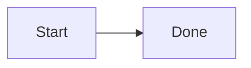

# DevHub · FE Panel

An internal web panel for a small frontend team: a per-user **Dashboard**, a **Backlog** task tracker
(list + board, manual entry and AI prompt-based entry), **Projects**, a curated **Learning** section and
per-project **Docs** (Markdown, charts, wireframe images, Mermaid diagrams).

One **Admin** can create, edit and delete everything; everyone else is a read-only **Viewer**.
Sign-in is by **mobile number + one-time code** (SuperTokens passwordless). There are no passwords and no
self sign-up: only numbers the admin adds on the Users page can sign in.

> Built to the MVP in *Frontend Developer Panel: Requirements v1.1* and the *UI Design Brief v1.0*.
> All names and numbers in the seed data are fake examples.

## Folder structure

```
devhub/
├── docker-compose.yml        # Postgres 17 + self-hosted SuperTokens core (local dev)
├── docker/postgres-init/     # creates the "supertokens" database on first start
├── backend/                  # API service: Express 5 + TypeScript + Prisma + supertokens-node
│   ├── prisma/               # schema.prisma, migrations/, seed.ts (fake example data)
│   ├── src/
│   │   ├── index.ts          # server entry (SuperTokens init, listen on PORT)
│   │   ├── app.ts            # Express app, routers, viewer read-only guard, error handler
│   │   ├── auth/             # SuperTokens passwordless (phone OTP) + session/role middleware
│   │   ├── routes/           # me, users, dashboard, tasks, ai, projects, learning, docs, uploads
│   │   └── lib/              # zod schemas, activity log, LLM client, draft parser, storage, phone utils
│   └── tests/                # permission tests + LLM draft-parser tests (vitest)
└── frontend/                 # Next.js 16 (App Router) + TypeScript + Tailwind CSS 4
    ├── app/                  # /login and the signed-in app: dashboard, backlog, projects, learning, docs, users
    ├── components/           # UI kit, task list/board/drawer, AI prompt + draft preview, Markdown/Mermaid/Chart, doc editor
    └── lib/                  # API client, SuperTokens web SDK init, types, formatting
```

The two apps are independent (separate `package.json`, lockfile and `.env`). The browser only talks to the
frontend; Next.js proxies every `/api/*` request (including SuperTokens' `/api/auth/*`) to the backend, so
session cookies are first-party locally and on Vercel.

## Run it locally on a Mac

Prerequisites: **Node.js 20.9+** (22/24 LTS recommended) with npm, and **Docker Desktop**.

### 1. Start Docker Desktop

Open Docker Desktop from Applications (or run `open -a Docker`) and wait until it says *Engine running*.
Check with:

```bash
docker info --format '{{.ServerVersion}}'
```

### 2. Start Postgres and the SuperTokens core

```bash
cd ~/Desktop/devhub
docker compose up -d
docker compose ps        # db and supertokens should be "running (healthy)" after ~30 s
```

This gives you Postgres on `localhost:5432` (user/password/db: `devhub`) and the SuperTokens core on
`localhost:3567`.

### 3. Backend (API on http://localhost:4000)

```bash
cd ~/Desktop/devhub/backend
cp .env.example .env     # defaults work with docker compose; no real keys needed
npm install              # also runs "prisma generate"
npm run db:deploy        # apply migrations
npm run db:seed          # fake example users, projects, tasks, learning items and docs
npm run dev              # watch mode; keep this terminal open: OTP codes are printed here
```

### 4. Frontend (web app on http://localhost:3000)

In a second terminal:

```bash
cd ~/Desktop/devhub/frontend
cp .env.example .env.local
npm install
npm run dev
```

### 5. Sign in

Open **http://localhost:3000**, enter a seeded number, click **Send code**, then copy the 6-digit code from
the **backend terminal** (`[DEV OTP] +919876500001 → code: 123456`). No SMS is sent in local dev.

| Seeded user (fake)   | Role             | Mobile number     |
|----------------------|------------------|-------------------|
| Asha Rao             | Admin            | +91 98765 00001   |
| Ravi Kumar           | Viewer           | +91 98765 00002   |
| Meera Iyer           | Viewer           | +91 98765 00003   |
| Daniel Fernandes     | Viewer           | +91 98765 00004   |
| Priya Nair           | Viewer, inactive | +91 98765 00005 (shows the "deactivated" message) |

Type the 10 digits with the +91 country code selected (for example `9876500001`).

To stop: `Ctrl+C` in both terminals, then `docker compose down` (add `-v` to delete the database volume).

## Scripts

| Where     | Command               | What it does |
|-----------|-----------------------|--------------|
| backend   | `npm run dev`         | API in watch mode (tsx) on `PORT` (4000) |
| backend   | `npm run build` / `npm start` | Compile to `dist/` / run the compiled server |
| backend   | `npm run db:deploy`   | Apply migrations (`prisma migrate deploy`) |
| backend   | `npm run db:migrate`  | Create a new migration after editing `schema.prisma` (dev) |
| backend   | `npm run db:seed`     | **Wipes** app tables and loads the fake example data |
| backend   | `npm run db:reset`    | Drop, re-migrate and re-seed the database |
| backend   | `npm test`            | Permission tests + LLM draft-parser tests (no database needed) |
| both      | `npm run lint` / `npm run typecheck` | ESLint / TypeScript |
| frontend  | `npm run dev` / `npm run build` / `npm start` | Next.js on port 3000 |

## Configuration

All configuration is via environment variables, documented in `backend/.env.example` and
`frontend/.env.example`. Never commit `.env` / `.env.local` (they are git-ignored).

- **Database:** `DATABASE_URL`. Local docker-compose by default; any hosted Postgres works (Neon, Supabase).
- **SuperTokens core:** `SUPERTOKENS_CONNECTION_URI` (+ `SUPERTOKENS_API_KEY`).
  - `http://localhost:3567`: self-hosted core from docker-compose (default).
  - `https://try.supertokens.com`: SuperTokens' public demo core, no container needed (shared and wiped
    periodically, so for trying things out only).
  - Production: SuperTokens managed core (connection URI + API key from their dashboard).
- **SMS:** `SMS_PROVIDER=console` prints codes to the backend console. Use `twilio` (with `TWILIO_*`) or
  `supertokens` (with `SUPERTOKENS_SMS_API_KEY`) for real SMS. SMS to Indian numbers normally needs DLT
  sender and template registration, which can take several days.
- **AI prompt entry:** `LLM_API_KEY`, `LLM_BASE_URL`, `LLM_MODEL` for any OpenAI-compatible chat completions
  API (JSON mode). Without a key, dev uses a deterministic keyword-based mock that is labelled **"Mock AI (dev)"**
  in the UI (`LLM_MOCK=true`). In production, or with `LLM_MOCK=false`, the UI shows a clear
  "AI drafting isn't configured" message and the manual form still works.
- **Uploads (wireframes):** `BLOB_READ_WRITE_TOKEN` stores images in Vercel Blob. Without it, images go to
  `backend/uploads/` on local disk and are served only to signed-in users.

## How permissions work

- Every request to `/api/*` needs a valid SuperTokens session. The backend loads the app user for that
  session, and **deactivated users are rejected and their sessions revoked**. Deactivating a user on the
  Users page also revokes all their sessions straight away.
- The backend rejects **every non-GET request from a Viewer with 403** (a global guard in `app.ts`), and each
  create, edit or delete route is also wrapped in `requireAdmin`. Viewers can't open another user's dashboard
  (403) and only get names from `/api/users`, not phone numbers.
- OTP codes are only sent to numbers that exist in the `users` table and are active. This is checked on the
  server before SuperTokens creates the code.
- The UI hides create, edit and delete controls from Viewers, but that is a convenience only.
- `backend/tests/permissions.test.ts` discovers every POST, PUT, PATCH and DELETE route from the routers and
  asserts a Viewer gets 403 (and an anonymous caller 401), so new routes are covered automatically.

## AI prompt-based task entry

The admin types into **Ask AI** (top bar, `⌘K`) or the prompt box on the Backlog page, for example
*"Add 3 tasks for the login page redesign, high priority, assign to Ravi"* or *"Move all Ravi's login
tasks to Review"*.

1. The backend sends the prompt plus the project, user and task lists to the LLM and asks for JSON only.
2. The reply is validated with zod (`src/lib/draft.ts`). Names are matched to real projects and users, and
   unknown names or dates are **flagged rather than guessed**. Updates are only allowed for existing task IDs
   and are shown as before → after diffs.
3. The admin edits, deselects or removes drafts, then clicks **Confirm and save**. Only then does
   `POST /api/tasks/bulk` write anything, in a single transaction, with activity log entries.

## Docs content format

Pages are stored as Markdown. The editor works in blocks (Text, Heading, List, Code, Chart, Image, Mermaid),
each with a live preview, and saves back to Markdown:

````markdown


```chart
{"type":"bar","title":"Tasks by status","data":[{"label":"To do","value":3},{"label":"Done","value":5}]}
```


````

Each project has its own doc space, plus a team-wide **General** space. Pages nest one level deep
(parent → child), and this is enforced by the API.

## Deployment notes

**Frontend → Vercel**

1. Import the repo in Vercel and set **Root Directory** to `frontend` (framework: Next.js).
2. Set the environment variable `BACKEND_URL=https://<your-backend-host>` and leave
   `NEXT_PUBLIC_DEV_OTP_HINT` unset.
3. Deploy. `/api/*` is rewritten to the backend, so the browser never calls the backend directly and
   cookies stay first-party on the Vercel domain.

**Backend: hosting options.** It is a standard long-running Node service, so it can't run as-is on Vercel.

- **Render, Railway or Fly.io** (simplest): build with `npm ci && npx prisma migrate deploy && npm run build`,
  start with `npm start`, Node 20+.
- **Google Cloud Run, AWS App Runner or a small VM** with the same commands (or your own Dockerfile).
- Production env: `NODE_ENV=production`, `DATABASE_URL` (Neon or Supabase; use the direct, non-pooled URL
  for `migrate deploy`), `WEBSITE_DOMAIN` and `API_DOMAIN` set to the Vercel URL, the managed SuperTokens URI
  and API key, `SMS_PROVIDER` with credentials, `LLM_API_KEY`, and `BLOB_READ_WRITE_TOKEN` (local disk on most
  hosts isn't persistent).
- Run `npm run db:seed` only for a demo environment: it wipes the app tables.

## Troubleshooting

- **`docker compose up` fails with "Cannot connect to the Docker daemon"**: start Docker Desktop first.
- **Port already in use (5432, 3567, 4000 or 3000)**: stop the other process, or change the port in
  `docker-compose.yml` or `.env` (and update `DATABASE_URL`, `PORT` or `BACKEND_URL` to match).
- **Image pull fails with `x509: certificate signed by unknown authority`**: your network (corporate proxy /
  VPN) intercepts TLS to Docker Hub. Either add the proxy's root certificate to Docker Desktop (ask IT), or use
  images you already have plus the public SuperTokens demo core:
  ```bash
  POSTGRES_IMAGE=postgres:16-alpine docker compose up -d db        # any cached postgres:15+ image works
  # backend/.env:  SUPERTOKENS_CONNECTION_URI=https://try.supertokens.com
  ```
  Postgres 15 or 16 works the same as 17 for this app. (If you ever switch the image's major version on an existing
  `devhub-pg` volume, run `docker compose down -v` first. This deletes the local DB, which you can re-seed.)
- **No OTP in the console**: check the number is a seeded or added user and active, and that the backend
  terminal shows `SMS provider: console`.
- **Signed out unexpectedly after re-seeding**: the seed recreates users, so just sign in again.
